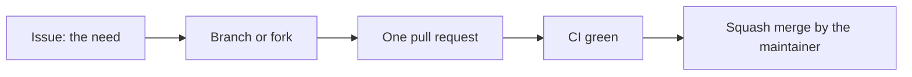

# Contributing

mcp-windbg has a single maintainer. Code, issues, pull requests and releases all live in this
repository, and every change takes the same path.

## Report a bug or ask for a feature

Open a [GitHub issue](https://github.com/janecekvit/mcp-windbg/issues/new/choose) with one of the two
forms; blank issues are off.

- **Change**, for a need the server does not meet yet: state the need, not the solution, tick the
  areas it touches and write the acceptance criteria as a checklist. A criterion is ticked only when a
  comment on the issue shows what ran and what it printed.
- **Bug**, for something that works wrong: the version or commit, how the service runs (single-file
  executable, Docker image, source), the steps, what you expected and what happened. A dump that shows
  a parser problem helps most when it is small; never attach a dump that holds someone else's data.

**A vulnerability is never an issue.** Report it privately, as [`SECURITY.md`](SECURITY.md) describes.

## Change the code

1. Start from an issue for anything larger than a typo, so the approach can be agreed before the work.
2. Work on a branch (or a fork) and open **one pull request per change**.
3. Write the pull request description as the commit message: pull requests are squash-merged with
   their title and description. The [template](.github/pull_request_template.md) has the shape: *Why*,
   *What changes*, *How to verify*, and `Closes #N` for the issue. Put notes for the reviewer in a
   comment, not in the description.
4. **Commits must be signed** (`main` accepts only verified signatures), and every discussion on the
   pull request must be resolved before it merges.

## What a change needs

- **Build and tests pass locally:** `dotnet build`, then `dotnet test`. The integration and crash
  scenario tests need Windows with cdb.exe; CI runs them on every pull request.
- **Tests come with the change.** New functionality and every bug fix get unit tests in the matching
  test project; a bug fix gets a test that fails without it. Code that reads untrusted input (dump
  files, debugger output, client symbol settings, commands for cdb.exe) also gets FsCheck property
  tests next to the existing `*PropertyTests` classes.
- **CI is green.** Every pull request runs the build with unit and integration tests, the diagram
  check, the Docker image build, CodeQL and zizmor. A pull request with a red check does not merge.
- **The security model holds.** A new endpoint or MCP tool gets a `DumpPolicies` policy and, if it
  takes a session or job id, an ownership check. User text for cdb.exe goes through `CdbCommandPolicy`.
  [`CLAUDE.md`](CLAUDE.md) describes the model.
- **Diagrams stay current.** When components or their connections change, edit
  `docs/architecture/architecture.d2` and run `Scripts/render-diagrams.sh`; flows over time are
  Mermaid diagrams in `docs/architecture/README.md`.
- **Workflow changes are checked** with `actionlint` and `zizmor --offline .github/workflows`. Actions are
  pinned to a full commit SHA of a release at least 14 days old.
- **Dependencies** go into `Directory.Packages.props`, at a version published at least 14 days earlier.

## What never goes into a commit

- No secret, token, password or private key.
- No private host or organisation name, no link to a private service or session, no personal e-mail
  address. Test data uses names such as `contoso`.
- Nothing in a language other than English: code, comments, documentation and commit messages.

## Releases

A release is a `vX.Y.Z` tag that the maintainer pushes. The release workflow builds the ZIP, signs
its build provenance and publishes the Docker image.

## License

Contributions are accepted under the [Apache License 2.0](LICENSE), the license of the project.
