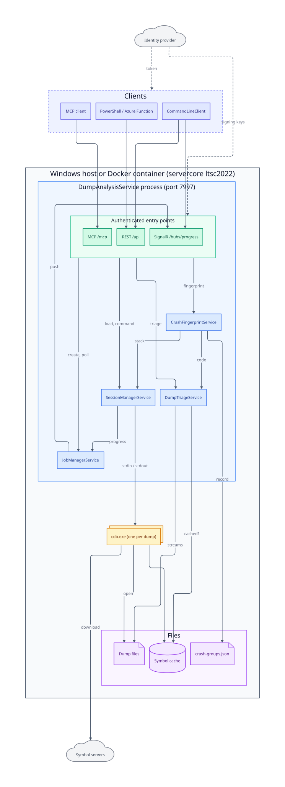

# WinDbg MCP Server

[](https://github.com/janecekvit/mcp-windbg/actions/workflows/build-and-release.yml)
[](https://codecov.io/gh/janecekvit/mcp-windbg)

MCP (Model Context Protocol) server for interactive debugging of Windows memory dump files using Microsoft Command Line Debugger (cdb.exe) or WinDbg.

## Features

- **Instant dump triage** (`triage_dump`): reads the minidump streams without the debugger or symbols, usually in well under a second. It returns a classified fault (null pointer, unloaded DLL, fill patterns, fail-fast code, C++ exception type and message, …), registers, threads, modules, memory, handles, a kernel bug check summary and next-step hints.
- **Crash fingerprints** (`fingerprint_crash`, `list_crash_groups`): give the same defect the same fingerprint across machines, ASLR layouts and rebuilds, and count dumps per crash group.
- **Interactive debugging**: a persistent CDB session for each dump file
- **Predefined analyses**: 10 specialised analyses (basic, exception, threads, heap, etc.)
- **Custom commands**: any WinDbg/CDB command, filtered by a [command policy](#security)
- **Session management**: several dump files open at once
- **MCP Streamable HTTP**, with progress notifications and the MCP Tasks extension
- **REST API** with the same job-based operations, plus SignalR progress notifications
- **Secure by default**: API key and/or OAuth 2.1 bearer tokens (Microsoft Entra ID or any OIDC provider) with roles, per-user sessions and an audit log; localhost-only host filter; restricted dump directories; a limit on concurrent sessions
- **Docker image**: Windows Server Core with the Debugging Tools preinstalled (`ghcr.io/janecekvit/mcp-windbg`)
- **Command-line client**: a standalone client for scripting and Azure Functions

## Architecture



One ASP.NET Core process serves MCP (`/mcp`), REST (`/api`) and SignalR progress (`/hubs/progress`), and runs one
`cdb.exe` per loaded dump. The diagram is rendered from [`docs/architecture/architecture.d2`](docs/architecture/architecture.d2);
sequence diagrams for loading a dump and for securing a request are in [`docs/architecture/README.md`](docs/architecture/README.md).

## Requirements

- .NET 10
- Windows SDK Debuggers (cdb.exe)
- Access to Microsoft symbol server (for downloading symbols)

## Installation

### Quick Installation (Single-file executable)
```powershell
# Build single-file executables
.\Scripts\Publish.ps1

# Start the MCP server
.\publish\win-x64\DumpAnalysisService.exe

# Or use the command-line client
.\publish\win-x64\CommandLineClient.exe help
```

### Development build
```bash
dotnet build
dotnet run --project DumpAnalysisService
```

## Running via Docker

Pre-built Windows container images are published to GitHub Container Registry on every release tag. Lets you run `DumpAnalysisService` as a sidecar without manually downloading the Release ZIP.

### Prerequisites

- **Windows host** with one of:
  - Docker Desktop in **Windows-containers** mode (Windows 10/11 Pro/Enterprise), or
  - Containers role on Windows Server 2019/2022.
- **Linux hosts cannot run Windows containers.** The image is Windows Server Core ltsc2022 — no Linux variant exists because `cdb.exe` is Windows-native.

### Quick start

```powershell
docker run -d --name windbg `
  -p 7997:7997 `
  -v C:\dumps:C:\dumps:ro `
  -v cdb-symbols:C:\symbols `
  -e Security__ApiKey=<long-random-secret> `
  -e Security__AllowedDumpDirectories__0=C:\dumps `
  ghcr.io/janecekvit/mcp-windbg:latest
```

The container listens on all interfaces, so **always set `Security__ApiKey`** when the port is reachable from other machines; clients then send it as the `X-Api-Key` header (see [Security](#security)). Without a key the service logs a startup warning.

No `-e Debugger__DefaultSymbolCache` is needed — the image already defaults the cache to `C:\symbols`, so you only mount a volume there. To override the location, see [Environment variables](#environment-variables).

Then call the REST API:

```powershell
Invoke-RestMethod http://localhost:7997/api/jobs -Headers @{ 'X-Api-Key' = '<secret>' }   # empty array []
```

### Connecting an MCP client / AI from outside the container

The service binds to all interfaces (`ASPNETCORE_URLS=http://+:7997`, baked into
the image), so the published port is reachable from the host or another machine.
Point your MCP client at:

- **Local host:** `http://localhost:7997/mcp`
- **Remote / Azure:** `http://<public-host-or-ip>:7997/mcp`

REST API and SignalR live under the same host at `/api` and `/hubs/progress`.
With `Security__ApiKey` set, add the key to the client's MCP configuration:

```json
"dump-analyzer": {
  "type": "http",
  "url": "http://<host>:7997/mcp",
  "headers": { "X-Api-Key": "${DUMP_ANALYSIS_API_KEY}" }
}
```

### docker-compose example

```yaml
services:
  windbg:
    image: ghcr.io/janecekvit/mcp-windbg:vX.Y.Z   # pin a real release tag, not :latest
    ports:
      - "7997:7997"
    volumes:
      - C:\dumps:C:\dumps:ro
      - cdb-symbols:C:\symbols
    environment:
      Security__ApiKey: ${DUMP_ANALYSIS_API_KEY}
      Security__AllowedDumpDirectories__0: C:\dumps
      Debugger__DefaultSymbolCache: C:\symbols
      Debugger__DefaultSymbolPathExtra: ""
      Debugger__DefaultSymbolServers: ""
    restart: unless-stopped

volumes:
  cdb-symbols:
```

### Environment variables

ASP.NET Core maps `Section__Key` env vars onto the `appsettings.json` tree, so the three debugger settings are:

| Env var | Maps to | Purpose |
|---|---|---|
| `Debugger__DefaultSymbolCache` | `Debugger:DefaultSymbolCache` | Local symbol cache directory inside the container (default in the container image: `C:\symbols` — mount a volume there so symbols persist across restarts; outside Docker the .exe defaults to `%LOCALAPPDATA%\DumpAnalysisService\symbols`) |
| `Debugger__DefaultSymbolPathExtra` | `Debugger:DefaultSymbolPathExtra` | Semicolon-separated extra local symbol paths (e.g. `C:\my-pdbs;\\server\symbols`) |
| `Debugger__DefaultSymbolServers` | `Debugger:DefaultSymbolServers` | Semicolon-separated base symbol servers (`srv*https://…`). An empty value keeps the built-in Microsoft/NuGet list; a value replaces it, so keep `srv*https://msdl.microsoft.com/download/symbols` in it |
| `Fingerprint__RegistryPath` | `Fingerprint:RegistryPath` | Crash group registry file; put it on a volume so groups survive restarts |
| `Security__ApiKey` | `Security:ApiKey` | Shared secret required on REST, MCP and SignalR (see [Security](#security)) |
| `Security__Jwt__Authority`, `Security__Jwt__Audiences__0`, … | `Security:Jwt:*` | OAuth bearer tokens, e.g. Microsoft Entra ID (see [OAuth bearer tokens](#oauth-bearer-tokens-microsoft-entra-id-keycloak-auth0)) |
| `Security__AllowedDumpDirectories__0` | `Security:AllowedDumpDirectories[0]` | Directory dumps may be loaded from (add `__1`, `__2`, … for more) |
| `AllowedHosts` | `AllowedHosts` | Accepted `Host` headers; the image sets `*`, `appsettings.json` defaults to localhost only |

### Pin a version

Always pin to `:vX.Y.Z` in production / scripted use. `:latest` is convenient locally but will silently roll forward when a new tag is pushed.

### Known limitations

- **First pull is ~3 GB** (Windows Server Core base + Debugging Tools + service binaries). Subsequent pulls only fetch changed layers.
- **First `load_dump` against a new symbol cache takes 10-30 minutes** while Microsoft Symbol Server downloads PDBs. Second run from the cached volume: 30-60 seconds.
- **Dump file paths must be visible inside the container** — mount the host directory containing dumps (e.g. `-v C:\dumps:C:\dumps:ro`) and pass that *container* path as `dump_file_path` (REST: `dumpFilePath`), not the host path.
- Symbol cache is intentionally **not pre-baked** into the image — symbols rotate every Patch Tuesday, so a baked cache would just rot. Mount a named volume (`cdb-symbols`) to make the cache survive container restarts.

### Deploying to Azure

The same image runs in Azure with configuration supplied entirely through app
settings (which Azure exposes as environment variables) — no rebuild, no
ENTRYPOINT edits. Pick a **Windows-container-capable** service:

| Service | Fit |
|---|---|
| Azure Container Instances (ACI) | Cheapest; good for a single instance or one instance per customer; no load balancer or autoscaling. |
| App Service for Containers (Windows) | Simplest managed option; built-in scale-out + load balancer (requires a Windows-container-capable plan, e.g. Premium v3). |
| AKS (Windows node pool) | Full orchestrator: autoscaling, load balancing, health probes across replicas. |

> **Azure Container Apps is NOT an option** — it does not support Windows
> containers, and `cdb.exe` is Windows-native (no Linux build exists).

**Shared symbol cache across replicas:** for the autoscaled options (App Service,
AKS), mount an **Azure Files** SMB share on `C:\symbols` in *every* replica.
Symbols download once and are shared behind the load balancer instead of each
replica re-downloading them. Azure Files supports concurrent multi-mount access;
the symsrv cache is read-mostly and uses file locking, so concurrent-write risk
is low. Set `Debugger__DefaultSymbolCache=C:\symbols` (already the image default)
and point the mount at it.

Deployment manifests themselves live in a separate repository — this section
documents only the image contract those manifests rely on.

## Automatic Debugger Detection

Server automatically detects available CDB/WinDbg installations:

- **Windows SDK** (preferred): `C:\Program Files (x86)\Windows Kits\10\Debuggers\x64\cdb.exe`
- **WinDbg Store App**: `C:\Program Files\WindowsApps\Microsoft.WinDbg_*\amd64\windbg.exe`
- **Various architectures**: x64, x86, amd64

Use the `detect_debuggers` tool to discover available installations.

## Configuration

The server supports multiple configuration methods with the following priority order (highest to lowest):
1. **Tool Parameters** — per-call overrides passed as MCP tool arguments (e.g. `load_dump` `symbol_cache`)
2. **HTTP Headers** — per-MCP-client defaults via `.mcp.json` (`X-Symbol-Cache`, `X-Symbol-Path-Extra`, `X-Symbol-Servers`)
3. **appsettings.json** — server-wide defaults (`Debugger:DefaultSymbolCache`, …)
4. **Built-in defaults**

### Configuration File

#### DumpAnalysisService Configuration
`DumpAnalysisService/appsettings.json` (next to the executable after publishing):
```json
{
  "AllowedHosts": "localhost;127.0.0.1;[::1]",
  "Debugger": {
    "DefaultSymbolCache": null,
    "DefaultSymbolPathExtra": null,
    "DefaultSymbolServers": "srv*https://msdl.microsoft.com/download/symbols;srv*https://symbols.nuget.org/download/symbols;srv*https://download.microsoft.com/download/symbols"
  },
  "Security": {
    "ApiKey": null,
    "AllowUnsafeCommands": false,
    "AllowClientSymbolOverrides": true,
    "AllowedDumpDirectories": [],
    "MaxConcurrentSessions": 10
  },
  "Fingerprint": {
    "RegistryPath": null,
    "RulesPath": null,
    "FrameCount": null
  }
}
```

| Setting | Default | Meaning |
|---|---|---|
| `Debugger:DefaultSymbolCache` | `%LOCALAPPDATA%\DumpAnalysisService\symbols` | Symbol cache directory |
| `Debugger:DefaultSymbolPathExtra` | none | Semicolon-separated local symbol paths, searched first |
| `Debugger:DefaultSymbolServers` | Microsoft, NuGet and Microsoft download symbol servers | The base server list, appended after any client servers. **Setting it replaces the built-in list**, so keep `srv*https://msdl.microsoft.com/download/symbols` in it. Entries are used verbatim, so write URLs as `srv*https://…` |

The cdb.exe path is not configured: the service [detects it](#automatic-debugger-detection). For the `Security` section see [Security](#security); for `Fingerprint`, see [list_crash_groups](#list_crash_groups).

#### Symbol Configuration Examples

The symbol path is built in this order: the cache, local paths (`DefaultSymbolPathExtra`, or the client's `symbol_path_extra`), the client's symbol servers (tool parameter or `X-Symbol-Servers` header), then `DefaultSymbolServers`. In client values, a URL becomes `srv*<url>`; a UNC or local path is added as is.

**Example 1: Company with an internal symbol server, for all clients**
```json
{
  "Debugger": {
    "DefaultSymbolCache": "D:\\SymbolCache",
    "DefaultSymbolPathExtra": "C:\\MyProject\\Debug",
    "DefaultSymbolServers": "srv*https://symbols.company.com;srv*https://msdl.microsoft.com/download/symbols"
  }
}
```
This gives the symbol path:
```
cache*D:\SymbolCache;C:\MyProject\Debug;srv*https://symbols.company.com;srv*https://msdl.microsoft.com/download/symbols
```

**Example 2: Extra servers for one MCP client only** (Microsoft servers stay, from the defaults)
```json
"headers": { "X-Symbol-Servers": "\\\\buildserver\\symbols;https://private-symbols.com" }
```

**Example 3: Local development only**
```json
{
  "Debugger": {
    "DefaultSymbolPathExtra": "C:\\MyPDBs;D:\\ThirdParty\\Symbols"
  }
}
```


## Security

The debugger runs with the service's permissions and reads whatever dump path it is given, so the service is locked down by default. All settings live in the `Security` section of `appsettings.json` (or `Security__*` environment variables):

| Setting | Default | Effect |
|---|---|---|
| `ApiKey` | none | When set, every REST, MCP and SignalR request needs `X-Api-Key: <key>` or `Authorization: Bearer <key>`; `GET /api/diagnostics/health` stays open for probes. **Set this or `Jwt` whenever the port is reachable from another machine.** The API key holder is an administrator. |
| `Jwt:*` | off | OAuth 2.1 / OpenID Connect bearer tokens with roles and per-user sessions, see [OAuth bearer tokens](#oauth-bearer-tokens-microsoft-entra-id-keycloak-auth0). Works alongside `ApiKey`. |
| `AllowUnsafeCommands` | `false` | `execute_command` refuses debugger meta-commands that act outside the dump: `.shell`, `.load`/`.loadby`, `.create`/`.attach`, `.writemem`/`.dump`/`.logopen`, `$<` script files, `.sympath`/`.srcpath` changes, `.server`, … Multi-line commands and `q`/`qq` are always refused (use `close_session`). cdb.exe additionally runs with `-noshell`. |
| `AllowClientSymbolOverrides` | `true` | When `false`, `X-Symbol-*` headers and the REST `symbols` body are ignored and only the server-side `Debugger:*` defaults are used (prevents clients from pointing the debugger at arbitrary UNC shares). Client values are always validated (no quotes, control characters, or extra path elements in the cache). |
| `AllowedDumpDirectories` | `[]` (any) | When non-empty, dumps can only be loaded from these directories. |
| `MaxConcurrentSessions` | `10` | Upper bound on open sessions (each one is a `cdb.exe` process). |

`AllowedHosts` in `appsettings.json` accepts only `localhost`, `127.0.0.1` and `[::1]`, which blocks DNS-rebinding attacks from a browser against a locally running service. The Docker image overrides it with `*` and relies on the API key instead.

`CommandLineClient` reads the key from the `DUMP_ANALYSIS_API_KEY` environment variable and an OAuth access token from `DUMP_ANALYSIS_ACCESS_TOKEN`. Neither is a command-line argument, because other users on the machine can list those.

### OAuth bearer tokens (Microsoft Entra ID, Keycloak, Auth0)

With `Security:Jwt:Authority` set, the service is an OAuth 2.1 **resource server**. It validates the access tokens an identity provider issues and never signs anyone in itself.

- A request without a valid credential gets `401`, with `WWW-Authenticate: Bearer resource_metadata="…/.well-known/oauth-protected-resource/mcp"`.
- That document is RFC 9728 protected resource metadata. It names the authorization server and the scopes, so an MCP client such as Claude Code can find where to sign in.
- The health probe and the metadata document stay anonymous.
- The API key keeps working next to tokens, for scripts and probes. Send it as `X-Api-Key`. A bearer value made of three dot-separated parts is treated as a JWT.

| Setting (`Security:Jwt:…`) | Default | Meaning |
|---|---|---|
| `Authority` | none (off) | The issuer. Its OpenID configuration supplies the signing keys and the expected issuer. Entra ID: `https://login.microsoftonline.com/<tenant-id>/v2.0` |
| `Audiences` | required | Accepted `aud` values. Entra ID: the API app's client id (v2 tokens) and/or `api://<client-id>` |
| `ValidIssuers` | the authority's | Extra accepted `iss` values, for example `https://sts.windows.net/<tenant-id>/` for Entra v1 tokens |
| `PublicBaseUrl` | from the request | The external URL advertised as the resource (`https://dumps.example.com`). Set it behind a proxy or gateway |
| `ScopesSupported` | `[]` | Scopes advertised in the metadata, e.g. `api://<client-id>/access_as_user` |
| `RoleClaimTypes` | `["roles"]` | Claims matched against the role names. Add `scp` / `scope` only for providers that put permissions there: an Entra scope is granted by user consent, not by assignment |
| `ReaderRole` / `AnalystRole` / `AdminRole` | `Dumps.Read` / `Dumps.Analyze` / `Dumps.Admin` | Role names |

**Roles.** Each role includes the ones below it. A valid token without any of these roles gets `403`. Any app in a tenant can obtain a token for your API through client credentials, so audience and issuer checks alone are not access control.

| Role | Allows |
|---|---|
| `Dumps.Read` | `list_jobs`, `list_analyses`, `list_crash_groups`, `detect_debuggers`; job status; SignalR progress for own jobs |
| `Dumps.Analyze` | Read, plus `triage_dump`, `load_dump`, `execute_command`, the analyses, `fingerprint_crash`, `close_session`, cancelling jobs |
| `Dumps.Admin` | Analyze, plus every user's sessions and jobs |

- **Tool list:** `tools/list` returns only the tools the caller's role allows.
- **Per-user sessions:** a session or job belongs to the caller who created it, identified by `oid`, else `sub`. Another non-admin caller gets `404`, the same as for a session that does not exist. `list_jobs` and `GET /api/jobs` show only the caller's own jobs. Sessions and jobs started with the API key are unowned, so only administrators and API-key callers see them.
- **Audit log:** the log category `DumpAnalysisService.Security.AuditLog` records `AUDIT <user> (<oid>) <action> session=<id> <dump path | command | analysis>` for each triage, load, command, analysis, fingerprint, close and cancel.

#### Microsoft Entra ID setup

1. **Register the API.** In *App registrations*, create a new registration (for example *WinDbg MCP Server*, single tenant).
   - *Expose an API*: set the Application ID URI to `api://<api-client-id>` and add the scope `access_as_user`.
   - *App roles*: create `Dumps.Read`, `Dumps.Analyze` and `Dumps.Admin`. Set *Allowed member types* to Users/Groups, plus Applications for service callers.
   - *Manifest*: set `"requestedAccessTokenVersion": 2` (in `api`), so tokens come from the v2 issuer.
2. **Restrict and assign.** In *Enterprise applications*, open the API: *Properties* → **Assignment required = Yes**. Under *Users and groups*, assign people or groups to the roles. Unassigned users then get no token at all.
3. **Register the client for Claude Code** (Entra ID has no dynamic client registration, so the client is registered once):
   - create a new registration, for example *WinDbg MCP – Claude Code*;
   - *Authentication* → *Mobile and desktop applications* → redirect URI `http://localhost:8080/callback`;
   - *API permissions* → *My APIs* → the API → `access_as_user` → grant admin consent.
4. **Configure the service**, as environment variables in the container or App Service:
   ```
   Security__Jwt__Authority=https://login.microsoftonline.com/<tenant-id>/v2.0
   Security__Jwt__Audiences__0=<api-client-id>
   Security__Jwt__Audiences__1=api://<api-client-id>
   Security__Jwt__PublicBaseUrl=https://dumps.example.com
   Security__Jwt__ScopesSupported__0=api://<api-client-id>/access_as_user
   ```
5. **Connect Claude Code.** It discovers the authority from the metadata and opens the sign-in in a browser:
   ```powershell
   claude mcp add --transport http --client-id <claude-client-id> --callback-port 8080 dump-analyzer https://dumps.example.com/mcp
   ```
   Or in `.mcp.json`:
   ```json
   "dump-analyzer": {
     "type": "http",
     "url": "https://dumps.example.com/mcp",
     "oauth": { "clientId": "<claude-client-id>", "callbackPort": 8080, "scopes": "api://<api-client-id>/access_as_user" }
   }
   ```
   If Claude Code cannot discover the authorization server, add `"authServerMetadataUrl": "https://login.microsoftonline.com/<tenant-id>/v2.0/.well-known/openid-configuration"` to `oauth`. Entra ID serves only the OpenID discovery document, not RFC 8414 metadata.

   **Without a client registration**, the Azure CLI can supply the token:
   - In the API's *Expose an API* → *Authorized client applications*, add the Azure CLI client id `04b07795-8ddb-461a-bbee-02f9e1bf7b46`.
   - Let Claude Code fetch the token at connect time with `headersHelper`. Its command prints `{"Authorization":"Bearer <token>"}`:
     ```json
     "dump-analyzer": {
       "type": "http",
       "url": "https://dumps.example.com/mcp",
       "headersHelper": "pwsh -NoProfile -Command \"@{ Authorization = 'Bearer ' + (az account get-access-token --resource api://<api-client-id> --query accessToken -o tsv) } | ConvertTo-Json -Compress\""
     }
     ```
6. **Services and scripts.** Azure Functions or pipelines:
   - assign an app role to the managed identity or service principal;
   - request a token for `api://<api-client-id>/.default`, for example with `DefaultAzureCredential`;
   - send it as `Authorization: Bearer`, or put it in `DUMP_ANALYSIS_ACCESS_TOKEN` for `CommandLineClient`.

**Other providers:** set `Authority` to the realm or tenant issuer URL and `Audiences` to the API's audience. If roles come in another claim, set `RoleClaimTypes` (Auth0: `permissions`; Keycloak with a client roles mapper: `roles`).

## MCP Tools

### triage_dump
Instant first look at a dump, read straight from its minidump streams: no debugger, no symbols, typically well under a second. Run it before `load_dump`, which can take minutes while symbols download.

**Parameters:**
- `dump_file_path`: Path to .dmp file

The symbol cache it checks is the one `load_dump` uses: the `X-Symbol-Cache` header, else `DefaultSymbolCache` (REST: optional `symbolCache` in the body, honouring `Security:AllowClientSymbolOverrides`).

**Returns** structured content (with an output schema):

| Section | Content |
|---|---|
| `dump` | size, SHA-256 (files up to 1 GB), full-memory flag, creation time, what the dump contains (`full-memory`, `handle-data`, `thread-info`, `memory-info`, `unloaded-modules`, `thread-names`, ...) and the dumper's comment |
| `system` | architecture, processor count, Windows version, product type |
| `process` | image name and path, PID, bitness, start time, uptime, CPU time; WoW64 (32-bit process in a 64-bit dump) and debug C runtime detection |
| `fault` | exception code, name and a stable `classification`; faulting thread and its name, address, module + offset, the faulting thread's registers. Details per exception: access type, target address and its memory region (free, reserved, guard, read-only, non-executable), unloaded module hit, fill patterns in the target or registers, fail-fast code, C++ type and `what()` message, delay-load DLL and function. `null` for a snapshot |
| `threads` | count, faulting thread, exited threads, the busiest threads (CPU time and share of their lifetime, start module), thread names |
| `modules` | count, how many belong to Windows, the faulting module plus every non-Windows module with version, timestamp, PDB name, GUID/age, symbol-server key and whether the PDB is cached; recently unloaded modules |
| `runtime` | .NET / .NET Framework and its version, when loaded |
| `memory` | private bytes, working set, virtual size, job commit limit, used and largest free address space (32-bit), system commit and physical memory |
| `handles` | open handles, per object type |
| `symbols` | symbol cache checked, how many PDBs are cached, which non-Windows ones are missing |
| `kernel` | for kernel dumps: bug check code, name, parameters and a decoded summary, dump type, crash time and system uptime (header only) |
| `hints` | plain-language next steps, e.g. "Null-pointer read (target 0x0) in app.exe+0x1a2b. Run basic_analysis for the faulting stack." |

States it recognises without the debugger:

| Area | States |
|---|---|
| Access violations | null pointer, null function pointer, call into or data access in an **unloaded DLL**, non-canonical (garbage) pointer, **fill patterns** (`0xDD`/`0xFEEEFEEE` freed, `0xCD`/`0xBAADF00D`/`0xCC` uninitialised, `0xFD`/`0xAB` guard bytes) in the target or a register, unallocated, reserved-only, guard and no-access pages, DEP (execute of non-executable memory), write to read-only memory |
| Exceptions | fail-fast with its `FAST_FAIL_*` code (GS cookie, CFG, CET shadow stack, heap corruption, `abort`), C++ throw with type and message, delay-load failure with DLL and function, in-page I/O error with status, out of memory, illegal instruction, DLL not found / entry point / init failure, CRT invalid parameter, `abort()`, assertion, possible deadlock, user callback exception, WinRT stowed exception, corrupt exception chain, Ctrl+C, harmless SetThreadName |
| Process | crash during startup, WoW64, debug build, busy loop (a thread near 100% CPU) or all threads waiting in a hang dump, handle leak, 32-bit address space exhaustion, job commit limit, system commit near the limit, private bytes near physical memory |
| Dump | missing handle data or full memory, dumper comment, symbols already cached or to be downloaded |
| Kernel | decoded parameters of the common bug checks (0xA, 0xD1, 0x50, 0x1E/0x7E/0x8E, 0x3B, 0x7F, 0x133, 0x139, 0xEF, 0xF4, 0x9F, 0x124, 0x101, 0xE2, ...), small dump |

Subject to `Security:AllowedDumpDirectories` like `load_dump`.

### load_dump
Loads a memory dump and creates a new debugging session.

**Parameters:**
- `dump_file_path`: Path to .dmp file
- `symbol_cache` *(optional)*: Symbol cache directory (overrides HTTP header and `appsettings.json` defaults)
- `symbol_path_extra` *(optional)*: Semicolon-separated additional local symbol paths
- `symbol_servers` *(optional)*: Semicolon-separated extra symbol servers (Microsoft public symbol server is always included)

### execute_command
Executes a WinDbg/CDB command in an existing session.

**Parameters:**
- `session_id`: Debugging session ID
- `command`: Command to execute (e.g., "kb", "!analyze -v"); one line, subject to the [command policy](#security)

### predefined_analysis
Runs a predefined analysis.

**Parameters:**
- `session_id`: Debugging session ID
- `analysis_type`: Analysis type (basic, exception, threads, heap, modules, handles, locks, memory, drivers, processes)

### basic_analysis
Runs basic analysis (equivalent to PowerShell script).

**Parameters:**
- `session_id`: Debugging session ID

### list_jobs
Lists all jobs with their current status.

**Parameters (optional):**
- `state`: Filter by job state (Queued, Running, Completed, Failed, Cancelled)

### list_analyses
Lists all available predefined analyses with descriptions.

### detect_debuggers
Detects available CDB/WinDbg installations on the system.

### fingerprint_crash
Reduces the crash in a loaded session to a **stable fingerprint**, so dumps of the same defect group together across machines, ASLR layouts and rebuilds, and records it in the crash group registry.

**Parameters:**
- `session_id`: Debugging session ID (from `load_dump`)

How it works: the exception code (and the dump's SHA-256) come from `triage_dump`, the faulting stack from `.ecxr; kn`. Frames every crash shares (exception dispatch in `ntdll`, `RaiseException`, `_CxxThrowException`, `abort`, WER, runtime throw and fail-fast helpers, thread start) are dropped; each frame is reduced to `module!function` (lowercase module, no offset, argument list, template arguments or funclet suffix; frames without symbols become `module+0xoffset`); recursion is collapsed (`f (×k)`, depth not hashed). The fingerprint is the first 12 hex characters of SHA-256 over the exception code and the first 5 meaningful frames.

**Returns** structured content: `fingerprint`, `quality` (`exact`: all frames symbolised, `partial`: some by offset, `weak`: no symbols, fewer than two meaningful frames, or a hang/break dump; weak fingerprints are reported but never grouped), exception code/name/classification, `title` (`<code name> in <top frame>`), the `frames` used, and from the registry: `recorded`, `isNew`, `isNewDump` (the same dump, by SHA-256, is counted once), `occurrences`, `firstSeenUtc`.

### list_crash_groups
Lists the known crash groups, most recently seen first: fingerprint, title, exception, frames, quality, first/last seen, occurrences and the dumps counted.

The registry is `%LOCALAPPDATA%\DumpAnalysisService\fingerprints.json`; the `Fingerprint` section of `appsettings.json` changes it:

| Setting | Default | Meaning |
|---|---|---|
| `Fingerprint:RegistryPath` | `%LOCALAPPDATA%\DumpAnalysisService\fingerprints.json` | Crash group registry file |
| `Fingerprint:RulesPath` | built-in `fingerprint-rules.json` | Rules file (`frameCount`, `ignoreFrames` globs like `"ntdll!Ki*"`) that replaces the built-in one |
| `Fingerprint:FrameCount` | 5 | Meaningful frames hashed |

Hang and deadlock fingerprints (which need waiter-chain analysis rather than a faulting stack) are not supported yet.

### close_session
Closes a debugging session and releases resources.

**Parameters:**
- `session_id`: ID of debugging session to close

## API Reference

In addition to MCP, `DumpAnalysisService` exposes the same job-based operations over a plain REST API (for PowerShell, Azure Functions, or any HTTP client) and supports the MCP Tasks extension.

### REST endpoints

All job-creating endpoints return `202 Accepted` with `{ jobId, statusEndpoint }`; poll `GET /api/jobs/{jobId}` until `state` is `Completed`, `Failed`, or `Cancelled`. Authoritative routes live in `JobsController.cs`, `CrashGroupsController.cs` and `DiagnosticsController.cs`.

| Method | Route | Purpose |
|---|---|---|
| `POST` | `/api/jobs/load-dump` | Create session by loading a dump file |
| `POST` | `/api/jobs/execute-command` | Run a WinDbg/CDB command in an existing session |
| `POST` | `/api/jobs/basic-analysis` | Run the comprehensive basic analysis |
| `POST` | `/api/jobs/predefined-analysis` | Run a named specialised analysis (heap, threads, …) |
| `POST` | `/api/jobs/close-session` | Close a session and release CDB |
| `POST` | `/api/jobs/triage-dump` | Read a dump's minidump streams without the debugger; the job result is the triage result as JSON |
| `POST` | `/api/jobs/fingerprint-crash` | Fingerprint the crash in a session (`{ sessionId }`) and record it; the job result is the fingerprint result as JSON |
| `GET`  | `/api/crash-groups` | Known crash groups, most recently seen first |
| `GET`  | `/api/jobs` | List jobs (optional `?state=Running`) |
| `GET`  | `/api/jobs/{jobId}` | Job status + progress |
| `POST` | `/api/jobs/{jobId}/cancel` | Cancel a running job |
| `GET`  | `/api/diagnostics/health` | Liveness probe (used by Docker `HEALTHCHECK`) |
| `GET`  | `/api/diagnostics/detect-debuggers` | Enumerate installed CDB/WinDbg installations |
| `GET`  | `/api/diagnostics/analyses` | List available predefined analysis types |

### MCP Tasks extension

The MCP server enables the Tasks extension (SEP-2663) from `ModelContextProtocol.Extensions.Tasks` with the SDK's in-memory task store. A client that declares the extension can run any tool call as a task and poll `tasks/get` (or cancel with `tasks/cancel`) instead of holding the request open; other clients keep receiving `notifications/progress` while the call runs. Every tool call still creates a job in `JobManagerService`, so the same work is visible through `GET /api/jobs`.

> MCP SDK 2.x replaced the experimental 1.x `IMcpTaskStore` API that the former `JobManagerBackedTaskStore` adapter implemented; `tasks/list` no longer exists in the protocol.

### SignalR progress hub

For real-time progress (instead of polling), connect to the SignalR hub at `/hubs/progress` and subscribe to a `jobId`. `CommandLineClient` uses this path via `Shared.Client.SignalRClientService`; the same approach works from any SignalR-capable client. Minimal C# example:

```csharp
using Shared.Client;
var signalR = new SignalRClientService(logger, "http://localhost:7997/hubs/progress");
await signalR.ConnectAsync();
var api = new DebuggerApiService(logger, new HttpClient(), signalR, "http://localhost:7997");
var sessionId = await api.LoadDumpAsync(@"C:\dumps\crash.dmp"); // polls REST; SignalR delivers progress callbacks
```

## Predefined Analyses

1. **basic** - Complete basic analysis (exception context, analyze -v, thread stacks)
2. **exception** - Detailed exception analysis with exception and context records
3. **threads** - Complete thread analysis including information and stacks
4. **heap** - Heap analysis including statistics and validation
5. **modules** - Module analysis (loaded, detailed, unloaded)
6. **handles** - Handle analysis including process handles
7. **locks** - Critical sections analysis and deadlock detection
8. **memory** - Virtual memory and address space analysis
9. **drivers** - Driver and device objects analysis
10. **processes** - Process analysis and process tree

## IDE Integration

### Claude Code Integration

#### 1. Build and Installation
```powershell
# Build single-file executable
.\Scripts\Publish.ps1
# or
dotnet publish DumpAnalysisService\DumpAnalysisService.csproj -c Release -r win-x64 -o publish\win-x64 --self-contained true -p:PublishSingleFile=true
```

#### 2. Configuration Options

**Method A: Global Configuration (all your projects)**

```powershell
claude mcp add --transport http --scope user dump-analyzer http://localhost:7997/mcp `
  --header "X-Symbol-Cache: D:\Symbols"
# With Security:ApiKey set on the service, also add: --header "X-Api-Key: <key>"
```

**Important:** You must start DumpAnalysisService.exe manually before using Claude Code:
```powershell
# Start the service (keep this running)
.\publish\win-x64\DumpAnalysisService.exe
```

**Method B: Project-specific Configuration (Recommended)**

Create `.mcp.json` in your project root:

```json
{
  "mcpServers": {
    "dump-analyzer": {
      "type": "http",
      "url": "http://localhost:7997/mcp",
      "headers": {
        "X-Symbol-Cache": "D:\\Symbols",
        "X-Symbol-Path-Extra": "",
        "X-Symbol-Servers": ""
      }
    }
  }
}
```

Start DumpAnalysisService separately:
```powershell
# In a separate terminal/PowerShell window
cd D:\Git\mcp-windbg\publish\win-x64
.\DumpAnalysisService.exe
```

**Symbol Configuration Options:**

The `load_dump` tool supports three configuration methods with priority order:

**1. Tool Parameters (Highest Priority - Per-Call)**

Pass symbol configuration directly in your prompt:
```
Load dump file D:\crash.dmp with symbol_cache="D:\Symbols" and symbol_servers="https://symbols.company.com"
```

Optional parameters:
- `symbol_cache` - Symbol cache directory
- `symbol_path_extra` - Additional local symbol directories (semicolon-separated)
- `symbol_servers` - Custom symbol servers (semicolon-separated)

**2. HTTP Headers (Per-MCP-Client Configuration)**

Configure in your `.mcp.json` to set defaults for your MCP client:
```json
{
  "mcpServers": {
    "dump-analyzer": {
      "type": "http",
      "url": "http://localhost:7997/mcp",
      "headers": {
        "X-Symbol-Cache": "D:\\Symbols",
        "X-Symbol-Path-Extra": "C:\\MyProject\\Debug",
        "X-Symbol-Servers": "https://symbols.company.com"
      }
    }
  }
}
```

**3. appsettings.json (Server-Wide Defaults)**

Edit `publish\win-x64\appsettings.json` or `DumpAnalysisService/appsettings.json` to set defaults for all MCP clients:
```json
{
  "Debugger": {
    "DefaultSymbolCache": "D:\\Symbols",
    "DefaultSymbolPathExtra": "C:\\MyProject\\Debug",
    "DefaultSymbolServers": "srv*https://symbols.company.com;srv*https://msdl.microsoft.com/download/symbols"
  }
}
```

#### 3. Usage in Claude Code

After you start DumpAnalysisService and configure Claude Code, these tools are available (see [MCP Tools](#mcp-tools)):

- `detect_debuggers`: check the debugger configuration
- `triage_dump`: instant first look at a dump, with no debugger and no symbols
- `load_dump`: load a dump file and create a session
- `basic_analysis`: complete crash analysis
- `execute_command`: custom CDB commands
- `predefined_analysis`: specialised analyses (heap, threads, modules, etc.)
- `fingerprint_crash` / `list_crash_groups`: has this crash been seen before, and how often
- `list_jobs`, `list_analyses`, `close_session`

**Example workflow:**
1. Start DumpAnalysisService.exe
2. Open Claude Code
3. "Use detect_debuggers to verify configuration"
4. "Triage D:\\crash.dmp"
5. "Load dump file D:\\crash.dmp with symbol_cache='D:\\Symbols'"
6. "Perform basic_analysis on session"
7. "Fingerprint the crash: have we seen it before?"
8. "Run predefined_analysis of type heap"

#### 4. Advanced Configuration

**Configuration Priority (from highest to lowest):**
1. **Tool Parameters** - Per-call override via prompt
2. **HTTP Headers** - Per-MCP-client configuration via `.mcp.json`
3. **appsettings.json** - Server-wide defaults for all clients

**Use Cases:**

- **Tool Parameters**: Override symbol configuration for a specific dump file
  ```
  Load dump D:\crash.dmp with symbol_servers="https://internal.company.com/symbols;\\fileserver\symbols"
  ```

- **HTTP Headers**: Configure defaults for your MCP client instance (e.g., your Claude Code)
  ```json
  {
    "mcpServers": {
      "dump-analyzer": {
        "type": "http",
        "url": "http://localhost:7997/mcp",
        "headers": {
          "X-Symbol-Cache": "D:\\MySymbols",
          "X-Symbol-Path-Extra": "C:\\MyProject\\Debug;D:\\ThirdParty\\Symbols",
          "X-Symbol-Servers": "https://internal.company.com/symbols"
        }
      }
    }
  }
  ```

- **appsettings.json**: Set server-wide defaults for all MCP clients
  ```json
  {
    "Debugger": {
      "DefaultSymbolCache": "D:\\SymbolCache",
      "DefaultSymbolPathExtra": "C:\\CommonSymbols",
      "DefaultSymbolServers": "srv*https://company-symbols.com;srv*https://msdl.microsoft.com/download/symbols"
    }
  }
  ```

**Example Scenario:**
- Server (`appsettings.json`): Default cache `D:\ServerSymbols`
- Your MCP client (`.mcp.json` headers): Override to `D:\MySymbols`
- Specific call (tool parameter): Override to `D:\ProjectSymbols` for one dump

Create `appsettings.Development.json` for development-specific settings.

## Command-Line Client (CommandLineClient)

Standalone command-line client for scripting, Azure Functions, and automation.

### Installation
```powershell
# Build with Publish.ps1
.\Scripts\Publish.ps1

# Client is in publish\win-x64\CommandLineClient.exe
```

### Usage

**Start DumpAnalysisService first:**
```powershell
# Terminal 1: Start the service
.\publish\win-x64\DumpAnalysisService.exe
```

**Then use the client:**
```powershell
# Terminal 2: Use the client
cd .\publish\win-x64

# Load dump
.\CommandLineClient.exe load "C:\dumps\crash.dmp"

# Execute command
.\CommandLineClient.exe exec session-id "!analyze -v"

# Run analysis
.\CommandLineClient.exe analyze session-id

# List jobs
.\CommandLineClient.exe list-jobs

# Close session
.\CommandLineClient.exe close session-id
```

### Symbol Configuration
```powershell
# Via command line parameters
.\CommandLineClient.exe --symbol-cache "D:\Symbols" load "C:\dumps\crash.dmp"
```

### Azure Functions Integration

```csharp
// Example Azure Function using CommandLineClient libraries
using Shared.Client;
using Microsoft.Extensions.Logging;

public static async Task<IActionResult> Run(
    [HttpTrigger(AuthorizationLevel.Function, "post")] HttpRequest req,
    ILogger log)
{
    var httpClient = new HttpClient();
    var signalRClient = new SignalRClientService(log, "http://localhost:7997/hubs/progress");
    await signalRClient.ConnectAsync();

    var apiService = new DebuggerApiService(log, httpClient, signalRClient, "http://localhost:7997");

    var dumpPath = req.Query["dumpPath"];
    var sessionId = await apiService.LoadDumpAsync(dumpPath);
    var analysis = await apiService.BasicAnalysisAsync(sessionId);

    return new OkObjectResult(analysis);
}
```

## Manual REST API testing

Quick PowerShell snippets for poking the REST API without an MCP client — useful for smoke tests, scripting, and debugging. For end-to-end testing against a real, reproducible dump, build and run `DumpAnalysisService.TestCrasher`, which self-mini-dumps via `dbghelp!MiniDumpWriteDump` (no third-party crashing app required):

```powershell
# Generate a fresh, hermetic dump (TestCrasher dumps itself, then exits)
dotnet run --project DumpAnalysisService.TestCrasher -- C:\dumps\crash.dmp
```

Service must be running at `http://localhost:7997`. All operations are job-based: `POST` returns `202 Accepted` with a `jobId`; poll `GET /api/jobs/{jobId}` until `state` is `Completed`, `Failed`, or `Cancelled`. With `Security:ApiKey` set, add `-Headers @{ 'X-Api-Key' = '<key>' }` to every call.

```powershell
# 0. Optional: instant triage, no debugger needed; the job result is the triage JSON
$triage = Invoke-RestMethod -Method Post `
  -Uri http://localhost:7997/api/jobs/triage-dump `
  -ContentType application/json `
  -Body (@{ dumpFilePath = 'C:\dumps\crash.dmp' } | ConvertTo-Json)


# 1. Load the dump → returns { jobId, statusEndpoint, message }
$create = Invoke-RestMethod -Method Post `
  -Uri http://localhost:7997/api/jobs/load-dump `
  -ContentType application/json `
  -Body (@{ dumpFilePath = 'C:\dumps\crash.dmp' } | ConvertTo-Json)

# 2. Poll until the load-dump job completes; the resulting sessionId is what every later call needs
do {
    Start-Sleep -Seconds 1
    $job = Invoke-RestMethod http://localhost:7997/api/jobs/$($create.jobId)
} until ($job.state -in 'Completed','Failed','Cancelled')
$sessionId = $job.sessionId
```

Once you have a `sessionId`, the other operations follow the same pattern (POST → poll the returned `jobId` → read `result` from the final job status):

```powershell
# Run !analyze -v + thread stacks + module list
Invoke-RestMethod -Method Post -Uri http://localhost:7997/api/jobs/basic-analysis `
  -ContentType application/json `
  -Body (@{ sessionId = $sessionId } | ConvertTo-Json)

# Execute an arbitrary CDB command
Invoke-RestMethod -Method Post -Uri http://localhost:7997/api/jobs/execute-command `
  -ContentType application/json `
  -Body (@{ sessionId = $sessionId; command = '!heap -s' } | ConvertTo-Json)

# Run a named predefined analysis (basic | exception | threads | heap | modules | handles | locks | memory | drivers | processes)
Invoke-RestMethod -Method Post -Uri http://localhost:7997/api/jobs/predefined-analysis `
  -ContentType application/json `
  -Body (@{ sessionId = $sessionId; analysisType = 'heap' } | ConvertTo-Json)

# Fingerprint the crash and record it in the crash group registry
Invoke-RestMethod -Method Post -Uri http://localhost:7997/api/jobs/fingerprint-crash `
  -ContentType application/json `
  -Body (@{ sessionId = $sessionId } | ConvertTo-Json)

# Known crash groups, most recently seen first (answers directly, no job)
Invoke-RestMethod http://localhost:7997/api/crash-groups
```

`DumpAnalysisService.IntegrationTests` automates this exact flow against a `TestCrasher`-generated dump and is the recommended pattern for verifying any change end-to-end.

## PowerShell Script Usage

For standalone usage without MCP:

```powershell
# Analyze dump using PowerShell script
.\Scripts\cdb.ps1 -DumpFile "C:\dumps\crash.dmp" -OutputFile "analysis.txt"
```

## Troubleshooting

### DumpAnalysisService won't start
- Check port 7997 is not in use: `netstat -ano | findstr :7997`
- Verify CDB is installed: run `detect_debuggers` tool
- Check logs in console output

### Symbol loading is slow
- First load downloads symbols (10-30 min)
- Subsequent loads use cache (30-60 sec)
- Configure symbol cache in appsettings.json for persistent cache

### Claude Code can't connect
- Ensure DumpAnalysisService.exe is running
- Verify configuration in `.mcp.json` or Claude config
- Check http://localhost:7997/api/diagnostics/health in browser
- `401 Unauthorized`: the service has `Security:ApiKey` or `Security:Jwt` set. Add the `X-Api-Key` header or sign in with a token. The `WWW-Authenticate` header says which: `resource_metadata` means OAuth. A `401` with a token usually means the audience or issuer does not match `Security:Jwt` (the service logs the reason).
- `403 Forbidden` with a token: the token has no `Dumps.*` role, or not a high enough one. Assign the user or app to an app role, then sign in again.
- `400 Invalid hostname`: the client reaches the service by a name that `AllowedHosts` does not list (it defaults to localhost)

## License

[Apache-2.0](./LICENSE), copyright Vít Janeček; see [NOTICE](./NOTICE).
