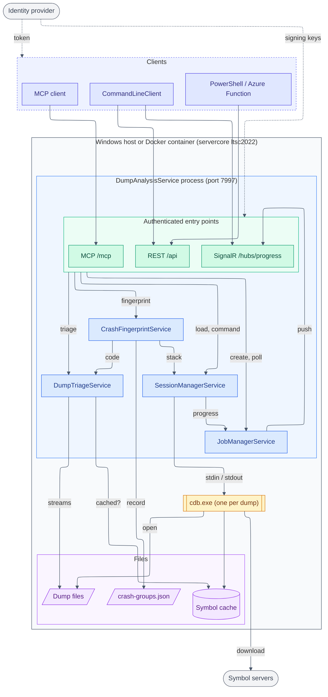
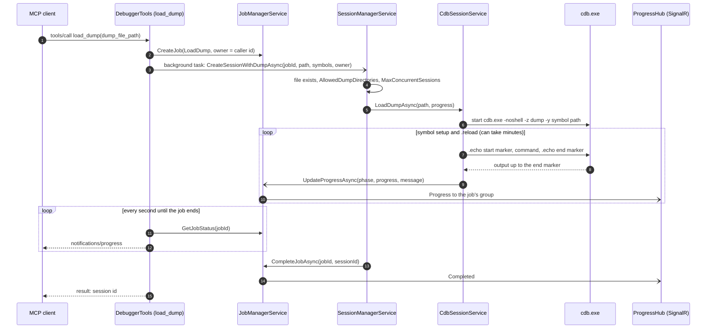
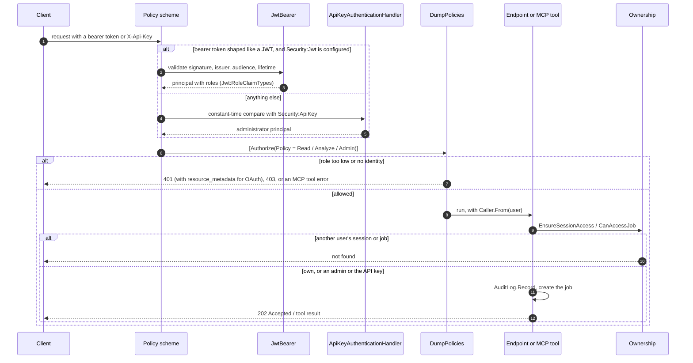

# Architecture

The flowchart below is the source of truth for the components, their connections and the trust and
process boundaries. It is Mermaid with the ELK layout, which GitHub renders inline: edit it here, there
is no generated file. The `%%` comments carry the details the picture leaves out.

Flows over time are drawn further down as Mermaid sequence diagrams.

## Components and boundaries

## Loading a dump (`load_dump`)

Every operation is a job. The MCP tool creates it at once, runs the work in a background task and
polls the job every second, forwarding progress to the client as MCP progress notifications. REST
clients get the job id back (202 Accepted) and follow it over SignalR or `GET /api/jobs/{id}`.

## Securing a request

Every REST, MCP and SignalR request takes the same path. With no credential configured, every caller
is unrestricted and the ownership check passes. `GET /api/diagnostics/health` is the one anonymous route.

