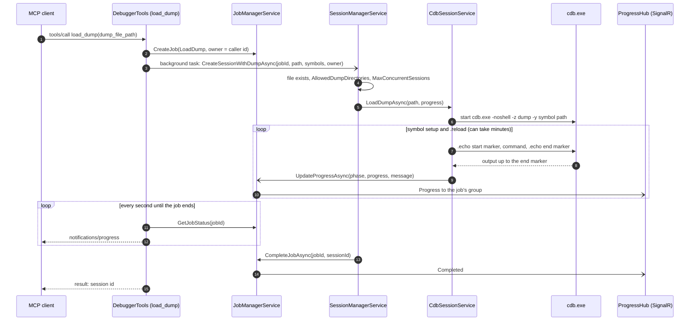
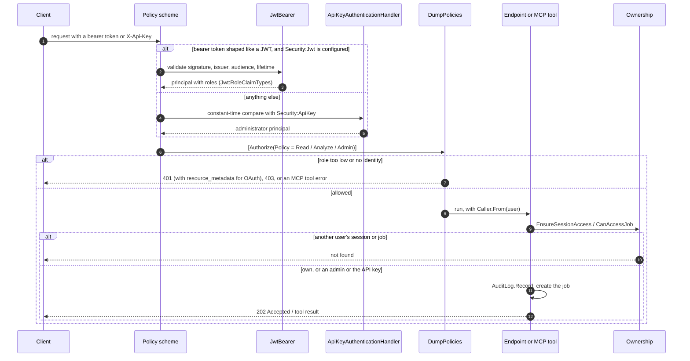

# Architecture

The diagram is rendered from [`architecture.d2`](architecture.d2), which is the source of truth for the
components, their connections and the trust and process boundaries. To change it, edit the `.d2`, run
`Scripts/render-diagrams.sh` and commit both files. CI fails when the SVG is stale.

Flows over time are drawn below as Mermaid sequence diagrams, which GitHub renders inline.

## Loading a dump (`load_dump`)

Every operation is a job. The MCP tool creates it at once, runs the work in a background task and
polls the job every second, forwarding progress to the client as MCP progress notifications. REST
clients get the job id back (202 Accepted) and follow it over SignalR or `GET /api/jobs/{id}`.

## Securing a request

Every REST, MCP and SignalR request takes the same path. With no credential configured, every caller
is unrestricted and the ownership check passes. `GET /api/diagnostics/health` is the one anonymous route.

