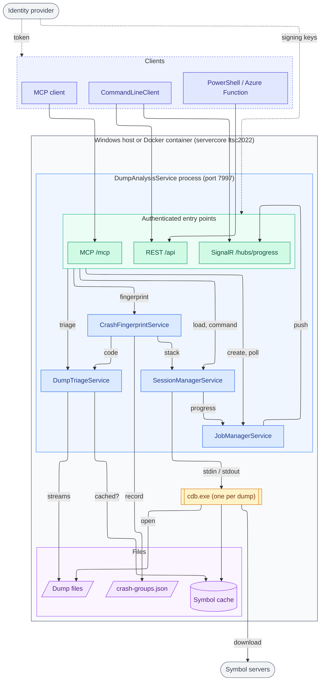
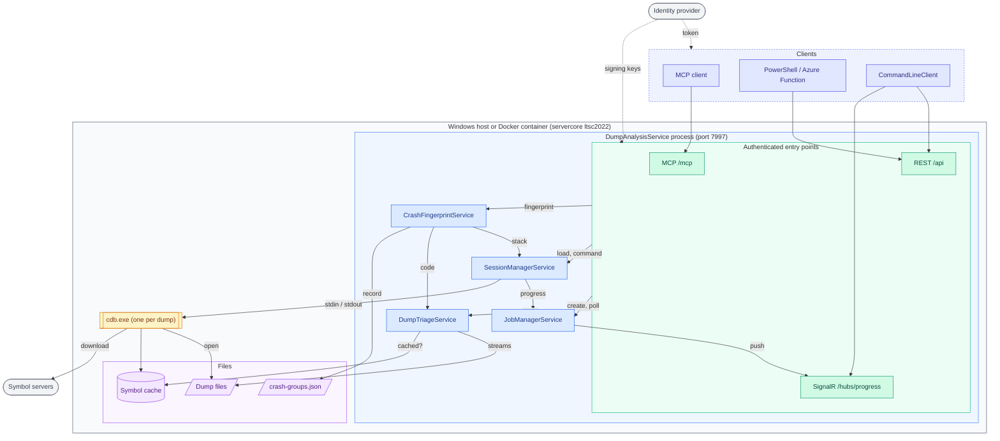

# Architecture in Mermaid (preview)

A preview of `architecture.d2` drawn as a Mermaid flowchart, to compare how GitHub renders it.
Same nodes, edges, colours and boundaries as the D2 source.

## ELK layout

## Default layout (dagre)

## D2 (current)

